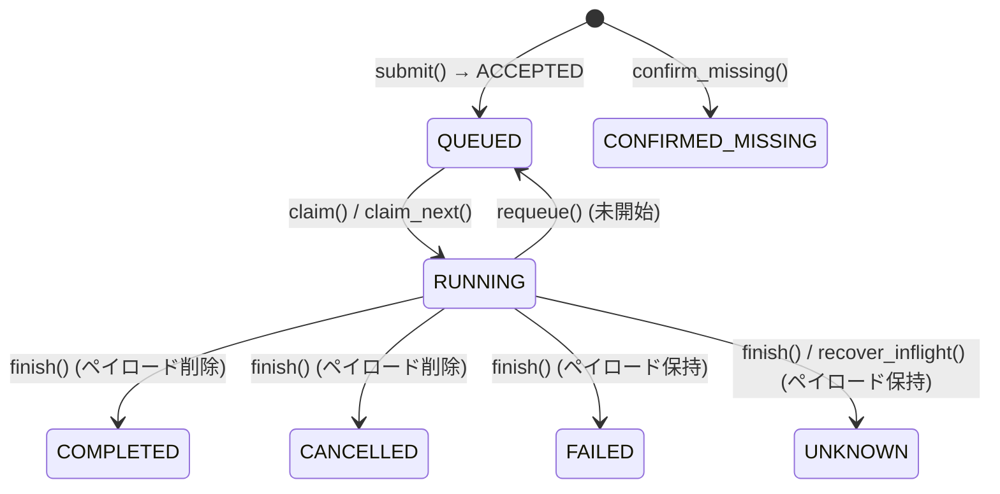

# Durable Chat Queue

[English](README.md) | [한국어](README.ko.md) | **日本語**

チャット/エージェントのバックエンド向けの、永続的かつ冪等なオペレーション受信箱
(operation inbox)です。SQLite ファイル 1 つと Python 標準ライブラリだけで動作し、
実行時の依存パッケージはありません。

チャットやエージェントのサービスは、いずれ次の 3 つの問いに答える必要があります。

- アシスタントが 1 通目のメッセージを処理している最中に、ユーザーが 2 通目を送った。
  **実行中のターンはどうなるのか?**
- 不安定なネットワーク上のスマートフォンが同じリクエストを再送した、あるいは 2 台の端末が
  同じ会話に同時に投稿した。**ターンは何回実行されるのか?**
- ツール呼び出し、メッセージ送信、有料 API 呼び出しがすでに起きたかもしれないターンの
  途中でサービスが再起動した。**そのターンをもう一度実行するのか?**

Durable Chat Queue の答えはこうです。実行中のターンはキャンセルも重複実行もされず、
新しいメッセージはその後ろに永続的に並びます。同じオペレーションの再送は識別されて既存の
結果が返されるだけで、二度実行されることはありません。クラッシュ時に実行中だった作業は
`UNKNOWN` とされ、自動で再実行されることはありません。

## なぜ必要か

チャット/エージェントのターンは、普通のバックグラウンドジョブとは違います。

- **会話の中には順序があります。** *n + 1* 番目のターンは *n* 番目の返答を前提に書かれます。
  並行に実行したり順序を入れ替えたりすると、古い文脈に答えることになります。
- **会話同士は独立しています。** 遅い会話が 1 つあるだけで、他の会話がすべて止まっては
  いけません。
- **副作用の結果が分からないことがあります。** モデル呼び出し、ツール呼び出し、外部への送信は、
  結果を記録する前にプロセスが落ちても、すでに反映されているかもしれません。「念のため」
  再実行すると、メッセージが二重に送られたり有料の呼び出しが繰り返されたりします。
- **クライアントは再送します。** モバイル回線は応答を失い、ユーザーは二度タップし、
  複数の端末が 1 つの会話を共有します。

メモリ上の「処理中」フラグでは、こうした境界のケースをうまく扱えません。2 通目が実行中の
ターンをキャンセルするか、拒否されるか、2 つ目のターンを並行に起動してしまいます。再起動すると、
待機中のメッセージを失うか、すべてを再実行してしまいます。このライブラリは、その判断を
小さなトランザクション状態機械に移します。

## 保証すること

前提: ローカルの SQLite ファイル 1 つを所有するサービスプロセス 1 つ(スレッドや asyncio
タスクの数は問わない)と、下記の[ディスパッチャーのパターン](#ディスパッチャーのパターン)の
手順に従う呼び出し側。

| 保証 | 仕組み |
|---|---|
| **冪等な投入。** `client_operation_id` は最大1回のみ受け付けます。同じ id・正規ペイロード・会話/端末/ワークスペース範囲なら状態を問わず既存行と `REPLAY` を返します。ペイロードや範囲が異なれば既存フィールドなしの `("CONFLICT", {})` です。`request_id` も別操作へ付け替えられません。 | グローバルな `UNIQUE` 制約、範囲比較、SHA-256 を1つの `BEGIN IMMEDIATE` 内で確認します。 |
| **サーバー受付順。** 受け付けた各オペレーションに増加する `sequence` が付きます。 | `INTEGER PRIMARY KEY AUTOINCREMENT` |
| **会話ごとに RUNNING は最大 1 つ、FIFO 順。** | `claim()` と `claim_next()` が、`QUEUED → RUNNING` の更新と同じ書き込みトランザクション内で、実行中の会話と最古の待機番号を確認します。 |
| **会話間の並列度の上限。** 同時に実行される会話は最大 `lanes` 個です。 | 同じトランザクション内で RUNNING の会話数を数えます。 |
| **再起動後の暗黙の再実行なし。** `recover_inflight()` は RUNNING の行をすべて `UNKNOWN` にします。まだ始まっていない `QUEUED` の行は残り、そのまま処理されます。 | `claim*()` は `QUEUED` の行しか選びません。 |
| **復旧用の受信箱。** `FAILED` と `UNKNOWN` はペイロードを保持します。`COMPLETED` と `CANCELLED` は本文を論理的に消し、ID・範囲・受領記録(`payload_sha256`、`message_id`、`error_code`、時刻)を残します。フォレンジック消去ではありません。 | `finish()` は両状態でのみ `payload_json=NULL` にし、接続ごとに `secure_delete=ON` を設定します(制約参照)。 |
| **不在の受領記録。** サーバーに届かなかったと判断して諦めたオペレーション id を、クライアントは `confirm_missing()` で封印できます。同じリクエストが遅れて届いても、識別されるだけでキューには入りません。 | 1 つのトランザクションで `CONFIRMED_MISSING` の墓標行を挿入します。 |

意図的に**しない**こともあります。実行中のターンはキャンセルしません(それは実行側の
役割で、結果は `CANCELLED` として記録します)。何も自動で再試行しません。`UNKNOWN` の作業を
どう扱うかも決めません。

## 設計

### 状態



`COMPLETED`、`CANCELLED`、`FAILED`、`UNKNOWN`、`CONFIRMED_MISSING` は最終状態で、
そこから行を動かすメソッドはありません。

### ストレージ

- テーブルは `chat_operations` の 1 つだけです。列は `sequence`、`client_operation_id`(一意)、
  `request_id`(一意)、`conversation_id`、`device_id`、`workspace_id`、`payload_sha256`、
  `payload_json`、`state`、`message_id`、`error_code`、`created_at`、`updated_at`、
  `started_at`、`completed_at` で、`(state, sequence)` と `(conversation_id, sequence)` に
  インデックスがあります。
- 公開メソッドは呼び出しごとに短命な接続を開きます(`busy_timeout=5000`、WAL ジャーナル)。
  確認してから書き込むメソッドは `BEGIN IMMEDIATE` で始まるため、確認と更新は同じファイルへの
  他のすべての書き込みと直列化されます。
- ペイロードは Python の `json.dumps(sort_keys=True, separators=(",", ":"), ensure_ascii=False, allow_nan=False)` を UTF-8 にし、SHA-256 でハッシュします。キー順序と JSON 書式の空白は無関係ですが、文字列内の空白は値の一部です。`NaN`、`Infinity`、`-Infinity` は DB を開く前に `ValueError` になります。**RFC 8785/JCS ではありません。** `1` と `1.0` は異なり、Unicode 正規化も行いません。信頼するサーバーで digest を計算するか Python クライアントも同じエンコーダーを使ってください。JavaScript 等のバイト列が一致するとは限りません。
- ペイロードの `workspace_id` は本文を消した後も範囲を保持する別カラムに保存します。バージョン0 DB は `BEGIN IMMEDIATE` で書き込みロックを取得し、バージョンを再確認して **一度だけ** `PRAGMA user_version=1` に移行します。なければカラムを追加し、すでにあっても保持された本文から一度だけ補完します。本文なし・不正・ワークスペースなしは `NULL` のままで次の呼び出しでは再走査しません。旧値は前後空白を除去し80文字超は無視します。専用キュー DB を使いスキーマ/バージョン欄を他アプリと共有しないでください。このロックは複数プロセスの実行/復旧対応を意味しません。
- このストアは受信箱であって、会話ログではありません。メッセージと返答は別の会話履歴に置き、
  ストアは識別子、順序、一時的なペイロード、受領記録だけを覚えます。

### ディスパッチャーのパターン

ライブサービスでは一度だけ drain するタスクではなく常駐ワーカーを使います。

1. **起動時:** リクエスト受付前に `recover_inflight()` を一度呼び、キューが空でも最大 `lanes` 個のドレインタスクを維持します。
2. **新しいリクエスト:** `submit()` を呼びます。
   - `CONFLICT` → 拒否(HTTP 409)。
   - `REPLAY` → 認可後に許可した受領フィールドのみ返し、行全体は公開しません。`CONFIRMED_MISSING` は拒否し、replay をインライン再実行しません。
   - `ACCEPTED` → `claim(op_id, lanes=lanes)` でその場での実行を試みます。`None` なら
     (会話が実行中、レーンが満杯、または同じ会話のより古いメッセージが待っている)、すぐに
     「待機中」と応答し、ドレインタスクに任せます。
3. **常駐ループ:** `claim_next(lanes=lanes)` → 実行 → `finish()`。`None` なら少し待って再試行し、**終了しません**。空キュー走査と送信が競合しても、インライン実行後に次のリクエストがなくても polling で後続を処理し、通知取りこぼしを避けます。
4. **結果の対応付け:** 成功 → `COMPLETED`、ユーザーによるキャンセル → `CANCELLED`、
   副作用の前に失敗したことが証明できる場合 → `FAILED`、それ以外の例外・応答の消失・ターン
   途中でのタスクキャンセル → `UNKNOWN`。実行側がターンをまったく開始せずに断った場合
   (例: メモリ上のレーンゲートと判断が食い違った)は `requeue()` を呼びます。
5. **終了:** 新規受付を止め、インライン処理を待ち、stop イベントを設定してドレインタスクを待ちます。進行中のターンは完了させ、残る QUEUED は次回起動まで保持します。DB/受領保存エラーでワーカーが黙って停止しないよう監視してください。この骨組みはサーバー実装ではありません。

最小限の asyncio の骨組みです(`run_turn` とエラー型は各自で実装)。

```python
import asyncio

async def drain(store, lanes, stop):
    while not stop.is_set():
        row = store.claim_next(lanes=lanes)
        if row is None:
            await asyncio.sleep(0.05)
        else:
            await execute(store, row)

async def start_drainers(store, lanes):
    store.recover_inflight()  # before requests or workers, once per owning process
    stop = asyncio.Event()
    tasks = [asyncio.create_task(drain(store, lanes, stop)) for _ in range(lanes)]
    return stop, tasks  # shutdown: stop.set(); await asyncio.gather(*tasks)

async def execute(store, row):
    op = row["client_operation_id"]
    try:
        reply = await run_turn(row["payload"])
    except asyncio.CancelledError:
        store.finish(op, state="UNKNOWN", error_code="cancelled_inflight_unknown")
        raise
    except ProvenPreSideEffectError as exc:
        store.finish(op, state="FAILED", error_code=type(exc).__name__)
    except Exception as exc:
        store.finish(op, state="UNKNOWN", error_code=f"{type(exc).__name__}:outcome_unknown")
    else:
        store.finish(op, state="COMPLETED", message_id=reply.message_id)
```

[`examples/threaded_dispatcher.py`](examples/threaded_dispatcher.py) は合成データとワーカースレッドを使う実行例です。標準の `run_workers()` は事前投入した有限バッチを30秒の安全上限内で drain します。ライブサービスでは `stop` に `threading.Event` を渡し、設定されるまで常駐させます。テストは空キューからのインライン実行後の後続処理と、空走査の境界での送信を検証します。

### 範囲と外部への受領記録

信頼するサーバー内部のストアであり、**認証層ではありません**。両 ID は会話ごとでなくグローバルに一意です。`submit()` は replay 前に会話・端末(`None` 含む)・保存済みワークスペース(`NULL` 含む)を比較し、全 conflict は `{}` を返します。未使用の新しい `request_id` で既存操作を照会できますが、別操作が所有する ID は奪えません。`confirm_missing()` は digest が異なっても同範囲のみ `EXISTING`、異なる範囲やリクエスト ID 衝突は `("CONFLICT", {})` です。ワークスペース不明の旧圧縮行は未指定のまま再結合しません。

認証済み呼び出し元から会話・端末・ワークスペースを導出して認可し、推測しにくいグローバル ID を使ってください。一般的な conflict でも ID の使用有無は分かり得ます。同範囲の replay/EXISTING 行には保持本文があり得るため、認可後に `client_operation_id`、`sequence`、`state`、`message_id` など許可フィールドだけ返してください。`get()`、`list()`、claim、`finish()`、`requeue()`、復旧は呼び出し元/所有トークンを検証しない信頼された管理操作です。未認証エンドポイントとして直接公開しないでください。

## クイックスタート

```bash
git clone https://github.com/willind421-hub/durable-chat-queue.git && cd durable-chat-queue
python -m pip install -e .
python examples/threaded_dispatcher.py
```

デモは標準で一時 DB を使います。`--db` は **新しいパスのみ** 受け付けます。既存ファイル(空ファイル含む)・ディレクトリ・シンボリックリンクと `-wal`、`-shm`、`-journal` 補助ファイルがあればストア生成前に拒否し、ファイルは排他的に作成します。同じパスへの競合 writer がいない信頼できるディレクトリを使ってください。補助ファイル検査はディレクトリ全体の原子的予約ではありません。運用 DB を指定しないでください。同じ `--db` での再実行は安全に失敗します。

```python
from pathlib import Path
from durable_chat_queue import ChatOperationStore

store = ChatOperationStore(Path("operations.db"))
store.recover_inflight()  # プロセス起動時、ワーカーが動く前に 1 回だけ

disposition, op = store.submit(
    client_operation_id="op-7f3a",  # クライアントが生成し、再送時もそのまま使う
    request_id="op-7f3a",
    conversation_id="conv-42",
    device_id="laptop",
    payload={"text": "Summarise this thread", "workspace_id": "team-a"},
)
# disposition は "ACCEPTED"、"REPLAY"、"CONFLICT" のいずれか

row = store.claim_next(lanes=2)
if row is not None:
    try:
        message_id = run_turn(row["payload"])  # モデル/ツールの呼び出し
    except Exception as exc:
        store.finish(row["client_operation_id"], state="UNKNOWN",
                     error_code=type(exc).__name__)
    else:
        store.finish(row["client_operation_id"], state="COMPLETED",
                     message_id=message_id)
```

サンプル出力の抜粋(時間の値は実行ごとに変わります):

```text
[2] restart: fence uncertain work, keep never-started work
  recover_inflight() fenced 1 operation(s)
  op-0001: UNKNOWN  error_code=service_restart_inflight_unknown
  op-0002: QUEUED   error_code=None
...
  retry  op-0004 with the same bytes:      REPLAY
  reuse  op-0004 with different content:   CONFLICT
...
  checked: per-conversation FIFO, no overlap inside a conversation, peak parallel turns = 2 (lanes = 2)
```

## API 概要

すべてのメソッドは同期的で、複数のスレッドから呼び出せます。呼び出しごとに別の接続を使います。

| 呼び出し | 用途 | 戻り値 |
|---|---|---|
| `ChatOperationStore(path)` | `path` の SQLite ファイルを使うストア(親ディレクトリは自動作成)。 | — |
| `submit(*, client_operation_id, request_id, conversation_id, device_id, payload)` | ターンを一度だけ受け付ける。 | `("ACCEPTED" \| "REPLAY" \| "CONFLICT", row)` |
| `claim(client_operation_id, *, lanes=1)` | 指定したオペレーションが会話内で最古の待機中で、会話が空いていて、レーンに空きがあるときだけ開始。 | row または `None` |
| `claim_next(*, lanes=1)` | レーンに空きがあれば、実行中でない会話の最古の待機オペレーションを開始。 | row または `None` |
| `finish(client_operation_id, *, state, message_id=None, error_code=None)` | RUNNING のオペレーションの受領記録を書く。`state` は `COMPLETED`、`FAILED`、`CANCELLED`、`UNKNOWN` のいずれか。 | row。それ以外の状態なら `ValueError`、RUNNING でなければ `KeyError` |
| `requeue(client_operation_id, *, error_code=None)` | 開始していない RUNNING のオペレーションを、同じ番号のまま `QUEUED` に戻す。 | `None` |
| `recover_inflight()` | RUNNING のオペレーションをすべて `UNKNOWN` にする。起動時のみ呼ぶ。 | 対象になった行数 |
| `confirm_missing(*, client_operation_id, request_id, conversation_id, device_id, workspace_id, payload_sha256)` | 未受信と判断した id を封印し、同範囲の既存行を照会。 | `("CONFIRMED_MISSING" \| "EXISTING", row)` または `("CONFLICT", {})` |
| `get(client_operation_id)` | オペレーションを 1 件取得。 | row または `None` |
| `list(*, conversation_id, after_sequence=0, limit=50)` | 会話のオペレーションをページ単位で取得(1〜100 行)。 | row のリスト |
| `counts()` | 状態ごとのオペレーション数。 | `dict[str, int]` |
| `canonical_payload(payload)` | Python エンコード JSON と SHA-256。`confirm_missing` 用 digest は信頼するサーバーでの計算を推奨。 | `(json_text, sha256_hex)`; 非有限数は `ValueError` |

row はテーブルの列を持つ `dict` で、`payload_json` の代わりに `payload`(デコードした dict、
削除済みなら `None`)が入ります。
`submit()` の全 `CONFLICT` は既存行ではなく空 dict を返します。

## テストの実行

```bash
python -m venv .venv
. .venv/bin/activate          # Windows: .venv\Scripts\activate
python -m pip install -e ".[test]"
pytest -q
```

CI は Ubuntu と Windows 上の Python 3.10 と 3.13 で、テストとサンプルを実行します。

## 制限事項と対象外

- **単一ホスト、単一の所有プロセス。** `BEGIN IMMEDIATE` により、claim はスレッド間でも同じ
  マシン上のプロセス間でもアトミックですが、リースやハートビートはありません。
  `recover_inflight()` は RUNNING の行を*すべて*封じるため、ワーカーが動く前の起動時にだけ
  呼んでください。また、それぞれがこのメソッドを呼ぶ複数のサービスプロセスで 1 つのファイルを
  共有しないでください。分散キューではなく、ファイルをネットワークファイルシステムに置くことも
  できません(SQLite の WAL は 1 台のホスト上の共有メモリを必要とします)。
- **信頼するサービス向け API であり認証・認可ではありません。** `submit()` と `confirm_missing()` の範囲確認は呼び出し元を認証しません。読み取り・状態変更メソッドに呼び出し元別の権限やワーカー fencing token はないため、信頼するサービスの背後でのみ使ってください。`requeue()` は不在または RUNNING 以外の作業には何もせず `None` を返すので、再投入成功の確認には使えません。
- **止まったワーカーはその会話を塞ぎます。** プロセスが生きたままワーカーが `finish()` を
  呼ばずに止まると、次の `recover_inflight()` まで、その会話は RUNNING のまま塞がります。
  すべての終了経路で受領記録を書いてください。
- **`lanes` は呼び出しごとの引数です。** 保存される設定ではないため、すべての呼び出し側が
  同じ値を渡す必要があります。
- **再試行ポリシーはありません。** 自動再試行、バックオフ、優先度、遅延配信、TTL、
  デッドレター処理はありません。`FAILED` と `UNKNOWN` の行は、アプリケーションや人が対応する
  まで待ち続け、それらをキューに戻す API もありません。再投入するには新しい
  `client_operation_id` を使います。
- **保持ポリシーはありません。** 受領記録を含む行は削除されません。アーカイブや整理は各自で
  行ってください。
- **人間のペースのトラフィック向けです。** 呼び出しごとに接続とバージョン確認を行い、移行/本文 backfill は一度だけです。SQLite 呼び出しは asyncio 骨組みでも同期式で、ロックで約5秒待つことがあります。高スループットのベンチマークはありません。
- **論理消去であり物理消去の保証ではありません。** `secure_delete=ON` はページ書き換え時の削除内容上書きを要求します。テストは checkpoint 後の主 DB にマーカーがないことを確認しますが、旧 WAL フレームや reader snapshot には本文が残り得ます。旧版で既に解放されたページ、バックアップ、ファイルシステム snapshot、SSD コピー、メモリ、アプリログは消去しません。暗号化や自動 checkpoint/安全消去ポリシーもありません。DB/補助ファイルのディレクトリ権限とバックアップを管理してください。ID・ワークスペース・ハッシュ・受領メタデータは残り、FAILED/UNKNOWN は本文を無期限に保持します。受領フィールドに秘密を入れないでください。
- ファイル権限は OS の既定値を継承し、ライブラリは強化しません。DB と補助ファイルのディレクトリ権限を制限してください。
- ペイロードは JSON にシリアライズできる dict である必要があり、サイズの制限はありません。
  古いデータの補完時、80 文字を超える `workspace_id` は無視されます。
- `confirm_missing()` は呼び出し元の digest を信頼し、不在の本文を検証できません。信頼するサーバーで `canonical_payload()` を使ってください。言語間の正規 JSON プロトコルではありません。
- 時刻はローカル時計による UTC の ISO-8601 文字列です。順序の判断には時刻ではなく、常に
  `sequence` を使います。

## 由来

このコードは終了した個人 AI アシスタント willind のデスクトップ/モバイルクライアントとローカルサービス間のコマンド受信箱から抽出しました。独立版は範囲付き照合、一度だけのロック付き移行、SQLite secure-delete 強化、非有限 JSON 拒否、回帰テストと合成ディスパッチャー例を追加しました。コメント/docstring は英語で、接続を明示的に閉じます。周囲の HTTP サービスは含みません。

## ライセンス

Apache License 2.0。[LICENSE](LICENSE) と [NOTICE](NOTICE) を参照してください。
