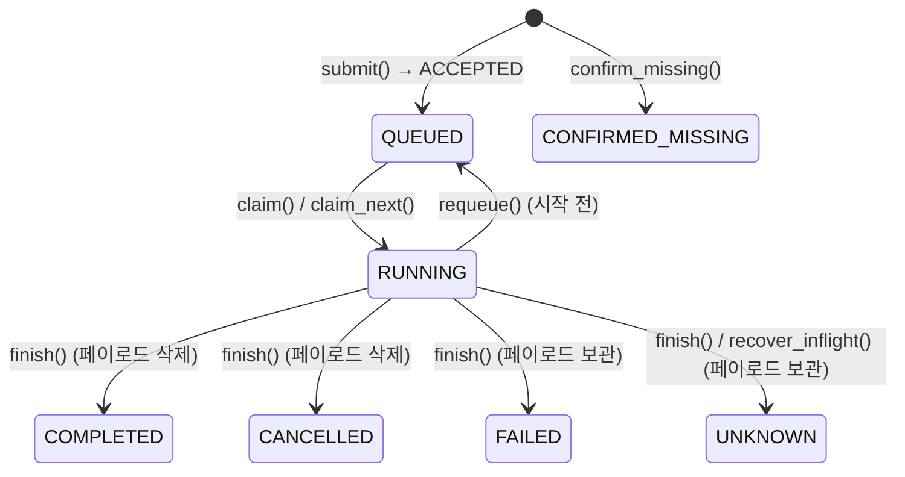

# Durable Chat Queue

[English](README.md) | **한국어** | [日本語](README.ja.md)

채팅·에이전트 백엔드를 위한 내구성 있고 멱등적인 작업 수신함(operation inbox)입니다.
SQLite 파일 하나와 파이썬 표준 라이브러리만으로 동작하며, 런타임 의존성이 없습니다.

채팅이나 에이전트 서비스를 만들다 보면 결국 다음 세 질문에 답해야 합니다.

- 어시스턴트가 첫 번째 메시지를 처리하는 도중에 사용자가 두 번째 메시지를 보냈다.
  **진행 중인 턴은 어떻게 되는가?**
- 네트워크가 불안정한 휴대폰이 같은 요청을 다시 보내거나, 기기 두 대가 같은 대화에
  동시에 메시지를 보냈다. **턴은 몇 번 실행되는가?**
- 도구 호출, 메시지 발송, 유료 API 호출이 이미 일어났을지도 모르는 턴 도중에 서비스가
  재시작됐다. **그 턴을 다시 실행하는가?**

Durable Chat Queue의 답은 이렇습니다. 진행 중인 턴은 취소되지도, 중복 실행되지도 않습니다.
새 메시지는 그 뒤에 내구적으로 줄을 섭니다. 같은 작업의 재시도는 알아보고 기존 결과를
돌려줄 뿐 두 번 실행하지 않습니다. 장애 순간 실행 중이던 작업은 `UNKNOWN`으로 표시되며
자동으로 다시 실행되지 않습니다.

## 왜 필요한가

채팅·에이전트 턴은 평범한 백그라운드 작업과 다릅니다.

- **대화 안에서는 순서가 있습니다.** *n + 1*번째 턴은 *n*번째 턴의 답을 전제로 쓰입니다.
  동시에 돌리거나 순서를 바꾸면 낡은 맥락에 답하게 됩니다.
- **대화끼리는 독립적입니다.** 느린 대화 하나 때문에 다른 대화가 모두 멈춰서는 안 됩니다.
- **부수 효과의 결과를 모를 수 있습니다.** 모델 호출, 도구 호출, 외부 발송은 프로세스가
  결과를 기록하기 전에 죽었더라도 이미 반영됐을 수 있습니다. "안전하게" 다시 돌리면
  메시지가 두 번 나가거나 유료 호출이 반복될 수 있습니다.
- **클라이언트는 재시도합니다.** 모바일 네트워크는 응답을 잃고, 사용자는 두 번 누르고,
  여러 기기가 한 대화를 공유합니다.

메모리 안의 "처리 중" 플래그로는 이런 경계 상황을 제대로 다루기 어렵습니다. 두 번째
메시지가 진행 중인 턴을 취소하거나, 거절되거나, 두 번째 턴을 동시에 띄웁니다. 재시작하면
대기 중이던 메시지를 잃거나 전부 다시 실행합니다. 이 라이브러리는 그 판단을 작은
트랜잭션 상태 기계로 옮깁니다.

## 보장하는 것

전제: 로컬 SQLite 파일 하나를 소유하는 서비스 프로세스 하나(스레드나 asyncio 태스크 수는
상관없음)와, 아래 [디스패처 패턴](#디스패처-패턴)의 절차를 지키는 호출자.

| 보장 | 방법 |
|---|---|
| **멱등 제출.** `client_operation_id`는 최대 한 번만 접수됩니다. 같은 id·정규 페이로드·대화/기기/작업공간 범위이면 상태와 상관없이 기존 행과 `REPLAY`를 돌려줍니다. 페이로드나 범위가 다르면 기존 필드 없는 `("CONFLICT", {})`입니다. `request_id`도 다른 작업에 다시 묶을 수 없습니다. | 전역 `UNIQUE` 제약, 범위 비교, SHA-256을 하나의 `BEGIN IMMEDIATE` 안에서 확인합니다. |
| **서버 접수 순서.** 접수된 작업마다 증가하는 `sequence`가 붙습니다. | `INTEGER PRIMARY KEY AUTOINCREMENT` |
| **대화당 RUNNING 작업은 최대 하나, FIFO 순서.** | `claim()`과 `claim_next()`가 `QUEUED → RUNNING` 갱신과 같은 쓰기 트랜잭션 안에서 실행 중인 대화와 가장 오래된 대기 순번을 확인합니다. |
| **대화 간 병렬도 상한.** 동시에 실행되는 대화는 최대 `lanes`개입니다. | 같은 트랜잭션에서 RUNNING 대화 수를 셉니다. |
| **재시작 후 조용한 재실행 없음.** `recover_inflight()`는 RUNNING 행을 모두 `UNKNOWN`으로 바꿉니다. 시작하지 않은 `QUEUED` 행은 그대로 남아 계속 처리됩니다. | `claim*()`은 `QUEUED` 행만 고릅니다. |
| **복구 수신함.** `FAILED`와 `UNKNOWN`은 페이로드를 보관합니다. `COMPLETED`와 `CANCELLED`는 본문을 논리적으로 비우고 ID·범위·영수증(`payload_sha256`, `message_id`, `error_code`, 시각)을 남깁니다. 포렌식 삭제는 보장하지 않습니다. | `finish()`는 두 상태에서만 `payload_json=NULL`로 만들며, 연결마다 `secure_delete=ON`을 설정합니다(한계 참조). |
| **부재 영수증.** 서버가 받지 못했다고 판단해 포기한 작업 id를 클라이언트가 `confirm_missing()`으로 봉인할 수 있습니다. 같은 요청이 뒤늦게 도착해도 알아보기만 하고 큐에 넣지 않습니다. | 한 트랜잭션에서 `CONFIRMED_MISSING` 묘비 행을 넣습니다. |

일부러 **하지 않는** 일도 있습니다. 실행 중인 턴을 취소하지 않고(실행기의 몫이며 결과는
`CANCELLED`로 기록합니다), 무엇도 자동 재시도하지 않으며, `UNKNOWN` 작업을 어떻게
처리할지도 정하지 않습니다.

## 설계

### 상태



`COMPLETED`, `CANCELLED`, `FAILED`, `UNKNOWN`, `CONFIRMED_MISSING`은 최종 상태이며, 이
상태에서 행을 옮기는 메서드는 없습니다.

### 저장 구조

- 테이블은 `chat_operations` 하나입니다. 열은 `sequence`, `client_operation_id`(고유),
  `request_id`(고유), `conversation_id`, `device_id`, `workspace_id`, `payload_sha256`,
  `payload_json`, `state`, `message_id`, `error_code`, `created_at`, `updated_at`,
  `started_at`, `completed_at`이고, `(state, sequence)`와 `(conversation_id, sequence)`에
  인덱스가 있습니다.
- 공개 메서드는 호출마다 짧게 쓰는 연결을 엽니다(`busy_timeout=5000`, WAL 저널).
  확인 후 쓰는 메서드는 `BEGIN IMMEDIATE`로 시작하므로, 확인과 갱신이 같은 파일의 다른
  모든 쓰기와 직렬화됩니다.
- 페이로드는 Python의 `json.dumps(sort_keys=True, separators=(",", ":"), ensure_ascii=False, allow_nan=False)`를 UTF-8로 인코딩하고 SHA-256으로 해시합니다. 키 순서와 JSON 표현의 공백은 무관하지만 문자열 안 공백은 값의 일부입니다. `NaN`, `Infinity`, `-Infinity`는 DB를 열기 전에 `ValueError`로 거부합니다. **RFC 8785/JCS가 아닙니다.** `1`과 `1.0`은 다르고 Unicode 정규화도 하지 않습니다. 신뢰하는 서버에서 digest를 계산하거나 Python 클라이언트도 같은 인코더를 쓰십시오. JavaScript 등 다른 언어의 바이트가 같다고 가정하지 마십시오.
- 페이로드의 `workspace_id`는 본문을 비운 뒤에도 범위가 남도록 별도 열에 저장합니다. 버전 0 DB는 `BEGIN IMMEDIATE`로 쓰기 잠금을 잡고 버전을 다시 확인한 뒤 **한 번만** `PRAGMA user_version=1`로 이행합니다. 열이 없으면 추가하고, 이미 있어도 남은 본문에서 한 번만 값을 채웁니다. 본문이 없거나 잘못됐거나 작업공간이 없으면 `NULL`로 두며 다음 호출에서 다시 훑지 않습니다. 옛 작업공간 값은 앞뒤 공백을 제거하고 80자를 넘으면 무시합니다. 전용 큐 DB를 쓰고 스키마/버전 필드를 다른 앱과 공유하지 마십시오. 이 잠금은 다중 프로세스 실행/복구 지원을 뜻하지 않습니다.
- 이 저장소는 수신함이지 대화 기록이 아닙니다. 메시지와 답변은 별도의 대화 기록에 두고,
  저장소는 식별자, 순서, 임시 페이로드, 영수증만 기억합니다.

### 디스패처 패턴

실시간 서비스는 한 번 비우고 종료하는 태스크 대신 상주 워커를 씁니다.

1. **시작 시:** 요청을 받기 전에 `recover_inflight()`를 한 번 호출하고 큐가 비어도 최대 `lanes`개의 드레인 태스크를 유지합니다.
2. **새 요청:** `submit()`을 호출합니다.
   - `CONFLICT` → 거절(HTTP 409).
   - `REPLAY` → 인가 후 허용된 영수증 필드만 반환하며 전체 행은 노출하지 않습니다. `CONFIRMED_MISSING`이면 거절하고 replay는 인라인 재실행하지 않습니다.
   - `ACCEPTED` → `claim(op_id, lanes=lanes)`로 그 자리에서 실행을 시도합니다. `None`이면
     (대화가 실행 중이거나, 레인이 모두 찼거나, 같은 대화의 더 오래된 메시지가 기다리는
     중) 곧바로 "대기 중"으로 응답하고 드레인 태스크가 가져가게 둡니다.
3. **상주 루프:** `claim_next(lanes=lanes)` → 실행 → `finish()`. `None`이면 잠깐 기다렸다 다시 시도하며 **종료하지 않습니다**. 빈 큐 조회와 제출이 겹치거나 인라인 실행 뒤 후속 요청이 없어도 polling으로 대기 꼬리를 실행해 알림 유실을 피합니다.
4. **결과 매핑:** 성공 → `COMPLETED`, 사용자 취소 → `CANCELLED`, 부수 효과 이전에 실패한
   것이 증명된 경우 → `FAILED`, 그 밖의 예외·응답 유실·턴 도중 태스크 취소 → `UNKNOWN`.
   실행기가 턴을 아예 시작하지 않고 거절했다면(예: 메모리 안의 레인 게이트와 판단이
   어긋난 경우) `requeue()`를 호출합니다.
5. **종료:** 신규 요청을 막고 인라인 작업을 기다린 뒤 stop 이벤트를 설정하고 드레인 태스크를 기다립니다. 진행 중인 턴은 끝내고 남은 QUEUED는 다음 시작까지 보존합니다. DB/영수증 기록 실패로 워커가 조용히 죽지 않도록 감시하십시오. 이 골격은 서버 구현이 아닙니다.

최소한의 asyncio 골격입니다(`run_turn`과 오류 타입은 직접 구현).

```python
import asyncio

async def drain(store, lanes, stop):
    while not stop.is_set():
        row = store.claim_next(lanes=lanes)
        if row is None:
            await asyncio.sleep(0.05)
        else:
            await execute(store, row)

async def start_drainers(store, lanes):
    store.recover_inflight()  # before requests or workers, once per owning process
    stop = asyncio.Event()
    tasks = [asyncio.create_task(drain(store, lanes, stop)) for _ in range(lanes)]
    return stop, tasks  # shutdown: stop.set(); await asyncio.gather(*tasks)

async def execute(store, row):
    op = row["client_operation_id"]
    try:
        reply = await run_turn(row["payload"])
    except asyncio.CancelledError:
        store.finish(op, state="UNKNOWN", error_code="cancelled_inflight_unknown")
        raise
    except ProvenPreSideEffectError as exc:
        store.finish(op, state="FAILED", error_code=type(exc).__name__)
    except Exception as exc:
        store.finish(op, state="UNKNOWN", error_code=f"{type(exc).__name__}:outcome_unknown")
    else:
        store.finish(op, state="COMPLETED", message_id=reply.message_id)
```

[`examples/threaded_dispatcher.py`](examples/threaded_dispatcher.py)는 합성 데이터와 워커 스레드를 쓰는 예제입니다. 기본 `run_workers()`는 미리 넣은 유한 배치를 30초 안전 한도 안에서 비웁니다. 실시간 서비스는 `stop`에 `threading.Event`를 넘겨 설정될 때까지 상주시킵니다. 테스트는 처음에 빈 큐에서 인라인 실행 뒤 대기 꼬리를 처리하는 경우와 빈 큐 조회 경계에서 제출하는 경우를 확인합니다.

### 범위와 외부 영수증

이 저장소는 신뢰하는 서버 내부용이며 **인증 계층이 아닙니다**. 두 ID는 대화별이 아닌 전역 유일값입니다. `submit()`은 replay 전에 대화·기기(`None` 포함)·저장된 작업공간(`NULL` 포함)을 비교하며 모든 충돌은 `{}`입니다. 쓰이지 않은 새 `request_id`로 기존 작업을 조회할 수 있지만 다른 작업이 소유한 ID는 가져오지 못합니다. `confirm_missing()`은 digest가 달라도 같은 범위만 `EXISTING`으로 돌려주고 범위/요청 ID 충돌은 `("CONFLICT", {})`입니다. 작업공간을 모르는 옛 압축 행은 미지정으로 유지하며 재결합하지 않습니다.

인증된 호출자로부터 대화·기기·작업공간을 도출하고 인가하며 추측하기 어려운 전역 ID를 쓰십시오. 일반 충돌 응답도 ID 점유 여부는 드러낼 수 있습니다. 같은 범위의 replay/EXISTING 행에는 보관된 본문이 있을 수 있으므로 인가 후 `client_operation_id`, `sequence`, `state`, `message_id` 같은 허용 필드만 노출하십시오. `get()`, `list()`, claim, `finish()`, `requeue()`, 복구는 호출자/소유권 토큰 검사가 없는 신뢰된 관리 작업입니다. 인증 없는 엔드포인트로 직접 노출하지 마십시오.

## 빠른 시작

```bash
git clone https://github.com/willind421-hub/durable-chat-queue.git && cd durable-chat-queue
python -m pip install -e .
python examples/threaded_dispatcher.py
```

데모는 기본적으로 임시 DB를 씁니다. `--db`는 **새 경로만** 받습니다. 기존 파일(빈 파일 포함)·디렉터리·심볼릭 링크와 `-wal`, `-shm`, `-journal` 보조 파일이 있으면 저장소 생성 전에 거부하며 파일 생성은 배타 모드입니다. 같은 경로에 경쟁 작성자가 없는 신뢰된 디렉터리를 쓰십시오. 보조 파일 검사는 디렉터리 전체를 원자적으로 예약하지 않습니다. 운영 DB를 지정하지 마십시오. 같은 `--db`로 다시 실행하면 안전하게 실패합니다.

```python
from pathlib import Path
from durable_chat_queue import ChatOperationStore

store = ChatOperationStore(Path("operations.db"))
store.recover_inflight()  # 프로세스 시작 시 워커가 돌기 전에 한 번만

disposition, op = store.submit(
    client_operation_id="op-7f3a",  # 클라이언트가 만들고 재시도할 때 그대로 재사용
    request_id="op-7f3a",
    conversation_id="conv-42",
    device_id="laptop",
    payload={"text": "Summarise this thread", "workspace_id": "team-a"},
)
# disposition은 "ACCEPTED", "REPLAY", "CONFLICT" 중 하나

row = store.claim_next(lanes=2)
if row is not None:
    try:
        message_id = run_turn(row["payload"])  # 모델·도구 호출
    except Exception as exc:
        store.finish(row["client_operation_id"], state="UNKNOWN",
                     error_code=type(exc).__name__)
    else:
        store.finish(row["client_operation_id"], state="COMPLETED",
                     message_id=message_id)
```

예제 출력 일부(시간 값은 실행마다 다름):

```text
[2] restart: fence uncertain work, keep never-started work
  recover_inflight() fenced 1 operation(s)
  op-0001: UNKNOWN  error_code=service_restart_inflight_unknown
  op-0002: QUEUED   error_code=None
...
  retry  op-0004 with the same bytes:      REPLAY
  reuse  op-0004 with different content:   CONFLICT
...
  checked: per-conversation FIFO, no overlap inside a conversation, peak parallel turns = 2 (lanes = 2)
```

## API 개요

모든 메서드는 동기식이며 여러 스레드에서 호출해도 됩니다. 호출마다 별도 연결을 씁니다.

| 호출 | 용도 | 반환 |
|---|---|---|
| `ChatOperationStore(path)` | `path`의 SQLite 파일을 쓰는 저장소(상위 폴더는 자동 생성). | — |
| `submit(*, client_operation_id, request_id, conversation_id, device_id, payload)` | 턴을 한 번만 접수. | `("ACCEPTED" \| "REPLAY" \| "CONFLICT", row)` |
| `claim(client_operation_id, *, lanes=1)` | 지정한 작업이 그 대화의 가장 오래된 대기 작업이고, 대화가 비어 있고, 레인에 여유가 있을 때만 시작. | row 또는 `None` |
| `claim_next(*, lanes=1)` | 레인에 여유가 있으면, 실행 중이 아닌 대화의 가장 오래된 대기 작업을 시작. | row 또는 `None` |
| `finish(client_operation_id, *, state, message_id=None, error_code=None)` | RUNNING 작업의 영수증 기록. `state`는 `COMPLETED`, `FAILED`, `CANCELLED`, `UNKNOWN` 중 하나. | row. 다른 상태면 `ValueError`, RUNNING이 아니면 `KeyError` |
| `requeue(client_operation_id, *, error_code=None)` | 시작하지 않은 RUNNING 작업을 같은 순번으로 `QUEUED`에 되돌림. | `None` |
| `recover_inflight()` | RUNNING 작업을 모두 `UNKNOWN`으로 표시. 시작 시에만 호출. | 처리한 행 수 |
| `confirm_missing(*, client_operation_id, request_id, conversation_id, device_id, workspace_id, payload_sha256)` | 미수신으로 판단한 id 봉인, 같은 범위 기존 행 조회. | `("CONFIRMED_MISSING" \| "EXISTING", row)` 또는 `("CONFLICT", {})` |
| `get(client_operation_id)` | 작업 하나 조회. | row 또는 `None` |
| `list(*, conversation_id, after_sequence=0, limit=50)` | 대화의 작업을 페이지 단위로 조회(1–100행). | row 목록 |
| `counts()` | 상태별 작업 수. | `dict[str, int]` |
| `canonical_payload(payload)` | Python 인코딩 JSON과 SHA-256. `confirm_missing`용 digest는 신뢰된 서버 계산 권장. | `(json_text, sha256_hex)`; 비유한 숫자는 `ValueError` |

row는 테이블 열을 담은 `dict`이며, `payload_json` 대신 `payload`(디코딩한 dict, 지워졌으면
`None`)가 들어 있습니다.
`submit()`의 모든 `CONFLICT`는 기존 행 대신 빈 dict를 반환합니다.

## 테스트 실행

```bash
python -m venv .venv
. .venv/bin/activate          # Windows: .venv\Scripts\activate
python -m pip install -e ".[test]"
pytest -q
```

CI는 Ubuntu와 Windows에서 Python 3.10과 3.13으로 테스트와 예제를 실행합니다.

## 한계와 비목표

- **단일 호스트, 단일 소유 프로세스.** `BEGIN IMMEDIATE` 덕분에 claim은 스레드 사이에서도,
  같은 머신의 프로세스 사이에서도 원자적이지만, 리스(lease)나 하트비트는 없습니다.
  `recover_inflight()`는 RUNNING 행을 *전부* 막으므로 워커가 돌기 전 시작 시점에만 호출하고,
  각자 이 메서드를 호출하는 서비스 프로세스 여러 개가 파일 하나를 공유하게 하지 마십시오.
  분산 큐가 아니며, 파일을 네트워크 파일 시스템에 두어서도 안 됩니다(SQLite WAL은 한
  호스트의 공유 메모리가 필요합니다).
- **신뢰된 서비스용 API이지 인증·권한 계층이 아닙니다.** `submit()`과 `confirm_missing()`의 범위 확인은 호출자를 인증하지 않습니다. 조회·상태 변경 메서드에는 호출자별 권한이나 워커 fencing token이 없으므로 신뢰된 서비스 뒤에서만 쓰십시오. `requeue()`는 없는 작업이나 RUNNING이 아닌 작업에서 조용히 아무것도 하지 않고 `None`을 반환하므로 재등록 성공 확인으로 쓰면 안 됩니다.
- **멈춘 워커는 그 대화를 막습니다.** 프로세스는 살아 있는데 워커가 `finish()` 없이 멈추면,
  다음 `recover_inflight()` 전까지 그 대화는 RUNNING 상태로 막혀 있습니다. 모든 종료 경로에서
  영수증을 기록하십시오.
- **`lanes`는 호출 인자입니다.** 저장되는 설정이 아니므로 모든 호출자가 같은 값을 넘겨야
  합니다.
- **재시도 정책이 없습니다.** 자동 재시도, 백오프, 우선순위, 지연 전달, TTL, 데드레터 처리가
  없습니다. `FAILED`와 `UNKNOWN` 행은 애플리케이션이나 사람이 처리할 때까지 기다리며, 이를
  다시 큐에 넣는 API도 없습니다. 다시 제출하려면 새 `client_operation_id`를 씁니다.
- **보존 정책이 없습니다.** 영수증을 포함한 행은 지워지지 않습니다. 보관·정리는 직접 하십시오.
- **사람 속도의 트래픽을 위한 설계입니다.** 매 호출마다 새 연결로 버전을 확인하며 이행/본문 backfill은 한 번만 합니다. SQLite 호출은 asyncio 골격에서도 동기식이고 잠금 때문에 약 5초 기다릴 수 있습니다. 고처리량 벤치마크는 없습니다.
- **논리적 비움이지 물리 삭제 보장이 아닙니다.** `secure_delete=ON`은 페이지가 다시 쓰일 때 삭제 내용을 덮어쓰도록 요청합니다. 테스트는 checkpoint 뒤 주 DB에서 표식이 사라짐을 확인하지만 옛 WAL 프레임과 reader snapshot에는 본문이 남을 수 있습니다. 구버전에서 이미 해제된 페이지, 백업, 파일시스템 snapshot, SSD 사본, 메모리, 앱 로그는 지우지 않습니다. 암호화나 자동 checkpoint/보안 삭제 정책도 없습니다. DB/보조 파일 디렉터리 권한과 백업을 관리하십시오. ID·작업공간·해시·영수증 메타데이터는 남고 FAILED/UNKNOWN 본문은 무기한 보관합니다. 영수증 필드에 비밀을 넣지 마십시오.
- 파일 권한은 OS 기본값을 따르며 라이브러리가 강화하지 않습니다. DB와 보조 파일 디렉터리 권한을 직접 제한하십시오.
- 페이로드는 JSON으로 직렬화할 수 있는 dict여야 하며, 크기 제한은 없습니다. 예전 데이터를
  채울 때 80자를 넘는 `workspace_id`는 무시합니다.
- `confirm_missing()`은 호출자의 digest를 신뢰하며 없는 본문을 검증할 수 없습니다. 신뢰된 서버에서 `canonical_payload()`로 계산하십시오. 언어 간 정규 JSON 프로토콜이 아닙니다.
- 시각은 로컬 시계 기준 UTC ISO-8601 문자열입니다. 순서 판단에는 시각이 아니라 항상
  `sequence`를 씁니다.

## 출처

이 코드는 개발이 중단된 개인 AI 비서 프로젝트 willind의 데스크톱·모바일 클라이언트와 로컬 서비스 사이 명령 수신함을 분리한 것입니다. 독립판은 범위별 조회 보호, 잠금 아래 한 번만 하는 이행, SQLite secure-delete 보강, 비유한 JSON 거부와 회귀 테스트·합성 디스패처 예제를 더했습니다. 주석/docstring은 영어이고 연결은 명시적으로 닫습니다. 주변 HTTP 서비스는 포함하지 않습니다.

## 라이선스

Apache License 2.0. [LICENSE](LICENSE)와 [NOTICE](NOTICE)를 참고하십시오.
