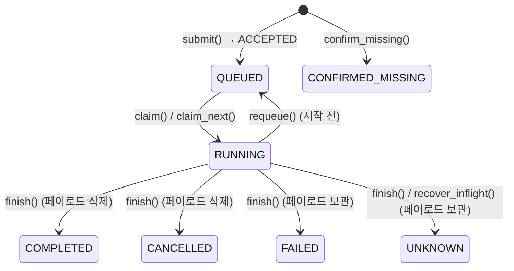

# Durable Chat Queue

[English](README.md) | **한국어** | [日本語](README.ja.md)

채팅·에이전트 백엔드를 위한 내구성 있고 멱등적인 작업 수신함(operation inbox)입니다.
SQLite 파일 하나와 파이썬 표준 라이브러리만으로 동작하며, 런타임 의존성이 없습니다.

채팅이나 에이전트 서비스를 만들다 보면 결국 다음 세 질문에 답해야 합니다.

- 어시스턴트가 첫 번째 메시지를 처리하는 도중에 사용자가 두 번째 메시지를 보냈다.
  **진행 중인 턴은 어떻게 되는가?**
- 네트워크가 불안정한 휴대폰이 같은 요청을 다시 보내거나, 기기 두 대가 같은 대화에
  동시에 메시지를 보냈다. **턴은 몇 번 실행되는가?**
- 도구 호출, 메시지 발송, 유료 API 호출이 이미 일어났을지도 모르는 턴 도중에 서비스가
  재시작됐다. **그 턴을 다시 실행하는가?**

Durable Chat Queue의 답은 이렇습니다. 진행 중인 턴은 취소되지도, 중복 실행되지도 않습니다.
새 메시지는 그 뒤에 내구적으로 줄을 섭니다. 같은 작업의 재시도는 알아보고 기존 결과를
돌려줄 뿐 두 번 실행하지 않습니다. 장애 순간 실행 중이던 작업은 `UNKNOWN`으로 표시되며
자동으로 다시 실행되지 않습니다.

## 왜 필요한가

채팅·에이전트 턴은 평범한 백그라운드 작업과 다릅니다.

- **대화 안에서는 순서가 있습니다.** *n + 1*번째 턴은 *n*번째 턴의 답을 전제로 쓰입니다.
  동시에 돌리거나 순서를 바꾸면 낡은 맥락에 답하게 됩니다.
- **대화끼리는 독립적입니다.** 느린 대화 하나 때문에 다른 대화가 모두 멈춰서는 안 됩니다.
- **부수 효과의 결과를 모를 수 있습니다.** 모델 호출, 도구 호출, 외부 발송은 프로세스가
  결과를 기록하기 전에 죽었더라도 이미 반영됐을 수 있습니다. "안전하게" 다시 돌리면
  메시지가 두 번 나가거나 유료 호출이 반복될 수 있습니다.
- **클라이언트는 재시도합니다.** 모바일 네트워크는 응답을 잃고, 사용자는 두 번 누르고,
  여러 기기가 한 대화를 공유합니다.

메모리 안의 "처리 중" 플래그로는 이런 경계 상황을 제대로 다루기 어렵습니다. 두 번째
메시지가 진행 중인 턴을 취소하거나, 거절되거나, 두 번째 턴을 동시에 띄웁니다. 재시작하면
대기 중이던 메시지를 잃거나 전부 다시 실행합니다. 이 라이브러리는 그 판단을 작은
트랜잭션 상태 기계로 옮깁니다.

## 보장하는 것

전제: 로컬 SQLite 파일 하나를 소유하는 서비스 프로세스 하나(스레드나 asyncio 태스크 수는
상관없음)와, 아래 [디스패처 패턴](#디스패처-패턴)의 절차를 지키는 호출자.

| 보장 | 방법 |
|---|---|
| **멱등 제출.** `client_operation_id`는 최대 한 번만 접수됩니다. 같은 id에 정규화한 페이로드까지 같으면 `REPLAY`(상태와 상관없이 기존 행), 같은 id에 페이로드가 다르면 `CONFLICT`입니다. `request_id`도 다른 작업에 다시 묶을 수 없습니다. | `UNIQUE` 제약과 정규화 JSON 페이로드의 SHA-256을 하나의 `BEGIN IMMEDIATE` 트랜잭션 안에서 확인합니다. |
| **서버 접수 순서.** 접수된 작업마다 증가하는 `sequence`가 붙습니다. | `INTEGER PRIMARY KEY AUTOINCREMENT` |
| **대화당 RUNNING 작업은 최대 하나, FIFO 순서.** | `claim()`과 `claim_next()`가 `QUEUED → RUNNING` 갱신과 같은 쓰기 트랜잭션 안에서 실행 중인 대화와 가장 오래된 대기 순번을 확인합니다. |
| **대화 간 병렬도 상한.** 동시에 실행되는 대화는 최대 `lanes`개입니다. | 같은 트랜잭션에서 RUNNING 대화 수를 셉니다. |
| **재시작 후 조용한 재실행 없음.** `recover_inflight()`는 RUNNING 행을 모두 `UNKNOWN`으로 바꿉니다. 시작하지 않은 `QUEUED` 행은 그대로 남아 계속 처리됩니다. | `claim*()`은 `QUEUED` 행만 고릅니다. |
| **복구 수신함.** `FAILED`와 `UNKNOWN` 행은 제출된 페이로드를 그대로 보관합니다. `COMPLETED`와 `CANCELLED` 행은 페이로드를 지우고 영수증(`payload_sha256`, `message_id`, `error_code`, 시각)만 남깁니다. | `finish()`는 `COMPLETED`, `CANCELLED`일 때만 페이로드를 지웁니다. |
| **부재 영수증.** 서버가 받지 못했다고 판단해 포기한 작업 id를 클라이언트가 `confirm_missing()`으로 봉인할 수 있습니다. 같은 요청이 뒤늦게 도착해도 알아보기만 하고 큐에 넣지 않습니다. | 한 트랜잭션에서 `CONFIRMED_MISSING` 묘비 행을 넣습니다. |

일부러 **하지 않는** 일도 있습니다. 실행 중인 턴을 취소하지 않고(실행기의 몫이며 결과는
`CANCELLED`로 기록합니다), 무엇도 자동 재시도하지 않으며, `UNKNOWN` 작업을 어떻게
처리할지도 정하지 않습니다.

## 설계

### 상태



`COMPLETED`, `CANCELLED`, `FAILED`, `UNKNOWN`, `CONFIRMED_MISSING`은 최종 상태이며, 이
상태에서 행을 옮기는 메서드는 없습니다.

### 저장 구조

- 테이블은 `chat_operations` 하나입니다. 열은 `sequence`, `client_operation_id`(고유),
  `request_id`(고유), `conversation_id`, `device_id`, `workspace_id`, `payload_sha256`,
  `payload_json`, `state`, `message_id`, `error_code`, `created_at`, `updated_at`,
  `started_at`, `completed_at`이고, `(state, sequence)`와 `(conversation_id, sequence)`에
  인덱스가 있습니다.
- 공개 메서드는 호출마다 짧게 쓰는 연결을 엽니다(`busy_timeout=5000`, WAL 저널).
  확인 후 쓰는 메서드는 `BEGIN IMMEDIATE`로 시작하므로, 확인과 갱신이 같은 파일의 다른
  모든 쓰기와 직렬화됩니다.
- 페이로드는 `json.dumps(sort_keys=True, separators=(",", ":"), ensure_ascii=False)`로
  정규화한 뒤 SHA-256으로 해시합니다. 키 순서와 공백은 영향이 없고, 값이 하나라도 바뀌면
  다른 페이로드가 됩니다.
- 페이로드에 `workspace_id` 키가 있으면 그 값을 별도 열에도 저장해, 페이로드를 지운 뒤에도
  범위 정보가 남습니다. 이 열이 없는 예전 데이터베이스를 열면 열을 추가하고, 아직
  페이로드가 남은 행은 값을 채웁니다. 이미 페이로드가 지워진 행은 추측하지 않고 `NULL`로
  둡니다.
- 이 저장소는 수신함이지 대화 기록이 아닙니다. 메시지와 답변은 별도의 대화 기록에 두고,
  저장소는 식별자, 순서, 임시 페이로드, 영수증만 기억합니다.

### 디스패처 패턴

원래 서비스에서는 asyncio 기반 HTTP 백엔드가 저장소를 다음처럼 사용했습니다.

1. **시작 시:** `recover_inflight()`를 한 번 호출한 뒤, 최대 `lanes`개의 드레인 태스크를
   띄웁니다.
2. **새 요청:** `submit()`을 호출합니다.
   - `CONFLICT` → 거절(HTTP 409).
   - `REPLAY` → 기존 영수증을 돌려줍니다. 행이 아직 `QUEUED`면 드레인 태스크가 도는지
     확인합니다. `CONFIRMED_MISSING`이면 거절합니다.
   - `ACCEPTED` → `claim(op_id, lanes=lanes)`로 그 자리에서 실행을 시도합니다. `None`이면
     (대화가 실행 중이거나, 레인이 모두 찼거나, 같은 대화의 더 오래된 메시지가 기다리는
     중) 곧바로 "대기 중"으로 응답하고 드레인 태스크가 가져가게 둡니다.
3. **드레인 루프:** `claim_next(lanes=lanes)` → 실행 → `finish()`를 `None`이 나올 때까지
   반복합니다.
4. **결과 매핑:** 성공 → `COMPLETED`, 사용자 취소 → `CANCELLED`, 부수 효과 이전에 실패한
   것이 증명된 경우 → `FAILED`, 그 밖의 예외·응답 유실·턴 도중 태스크 취소 → `UNKNOWN`.
   실행기가 턴을 아예 시작하지 않고 거절했다면(예: 메모리 안의 레인 게이트와 판단이
   어긋난 경우) `requeue()`를 호출합니다.

최소한의 asyncio 골격입니다(`run_turn`과 오류 타입은 직접 구현).

```python
import asyncio

async def drain(store, lanes):
    while (row := store.claim_next(lanes=lanes)) is not None:
        await execute(store, row)

async def execute(store, row):
    op = row["client_operation_id"]
    try:
        reply = await run_turn(row["payload"])
    except asyncio.CancelledError:
        store.finish(op, state="UNKNOWN", error_code="cancelled_inflight_unknown")
        raise
    except ProvenPreSideEffectError as exc:
        store.finish(op, state="FAILED", error_code=type(exc).__name__)
    except Exception as exc:
        store.finish(op, state="UNKNOWN", error_code=f"{type(exc).__name__}:outcome_unknown")
    else:
        store.finish(op, state="COMPLETED", message_id=reply.message_id)
```

[`examples/threaded_dispatcher.py`](examples/threaded_dispatcher.py)는 같은 패턴을 스레드로
구현해 합성 데이터로 실행해 볼 수 있는 예제입니다.

## 빠른 시작

```bash
git clone <this repository> && cd durable-chat-queue
python -m pip install -e .
python examples/threaded_dispatcher.py
```

```python
from pathlib import Path
from durable_chat_queue import ChatOperationStore

store = ChatOperationStore(Path("operations.db"))
store.recover_inflight()  # 프로세스 시작 시 워커가 돌기 전에 한 번만

disposition, op = store.submit(
    client_operation_id="op-7f3a",  # 클라이언트가 만들고 재시도할 때 그대로 재사용
    request_id="op-7f3a",
    conversation_id="conv-42",
    device_id="laptop",
    payload={"text": "Summarise this thread", "workspace_id": "team-a"},
)
# disposition은 "ACCEPTED", "REPLAY", "CONFLICT" 중 하나

row = store.claim_next(lanes=2)
if row is not None:
    try:
        message_id = run_turn(row["payload"])  # 모델·도구 호출
    except Exception as exc:
        store.finish(row["client_operation_id"], state="UNKNOWN",
                     error_code=type(exc).__name__)
    else:
        store.finish(row["client_operation_id"], state="COMPLETED",
                     message_id=message_id)
```

예제 출력 일부(시간 값은 실행마다 다름):

```text
[2] restart: fence uncertain work, keep never-started work
  recover_inflight() fenced 1 operation(s)
  op-0001: UNKNOWN  error_code=service_restart_inflight_unknown
  op-0002: QUEUED   error_code=None
...
  retry  op-0004 with the same bytes:      REPLAY
  reuse  op-0004 with different content:   CONFLICT
...
  checked: per-conversation FIFO, no overlap inside a conversation, peak parallel turns = 2 (lanes = 2)
```

## API 개요

모든 메서드는 동기식이며 여러 스레드에서 호출해도 됩니다. 호출마다 별도 연결을 씁니다.

| 호출 | 용도 | 반환 |
|---|---|---|
| `ChatOperationStore(path)` | `path`의 SQLite 파일을 쓰는 저장소(상위 폴더는 자동 생성). | — |
| `submit(*, client_operation_id, request_id, conversation_id, device_id, payload)` | 턴을 한 번만 접수. | `("ACCEPTED" \| "REPLAY" \| "CONFLICT", row)` |
| `claim(client_operation_id, *, lanes=1)` | 지정한 작업이 그 대화의 가장 오래된 대기 작업이고, 대화가 비어 있고, 레인에 여유가 있을 때만 시작. | row 또는 `None` |
| `claim_next(*, lanes=1)` | 레인에 여유가 있으면, 실행 중이 아닌 대화의 가장 오래된 대기 작업을 시작. | row 또는 `None` |
| `finish(client_operation_id, *, state, message_id=None, error_code=None)` | RUNNING 작업의 영수증 기록. `state`는 `COMPLETED`, `FAILED`, `CANCELLED`, `UNKNOWN` 중 하나. | row. 다른 상태면 `ValueError`, RUNNING이 아니면 `KeyError` |
| `requeue(client_operation_id, *, error_code=None)` | 시작하지 않은 RUNNING 작업을 같은 순번으로 `QUEUED`에 되돌림. | `None` |
| `recover_inflight()` | RUNNING 작업을 모두 `UNKNOWN`으로 표시. 시작 시에만 호출. | 처리한 행 수 |
| `confirm_missing(*, client_operation_id, request_id, conversation_id, device_id, workspace_id, payload_sha256)` | 서버가 받지 못했다고 클라이언트가 판단한 id를 봉인. | `("CONFIRMED_MISSING" \| "EXISTING", row)` |
| `get(client_operation_id)` | 작업 하나 조회. | row 또는 `None` |
| `list(*, conversation_id, after_sequence=0, limit=50)` | 대화의 작업을 페이지 단위로 조회(1–100행). | row 목록 |
| `counts()` | 상태별 작업 수. | `dict[str, int]` |
| `canonical_payload(payload)` | 정규화 JSON과 그 SHA-256(`confirm_missing`용으로 클라이언트에서도 사용). | `(json_text, sha256_hex)` |

row는 테이블 열을 담은 `dict`이며, `payload_json` 대신 `payload`(디코딩한 dict, 지워졌으면
`None`)가 들어 있습니다.

## 테스트 실행

```bash
python -m venv .venv
. .venv/bin/activate          # Windows: .venv\Scripts\activate
python -m pip install -e ".[test]"
pytest -q
```

CI는 Ubuntu와 Windows에서 Python 3.10과 3.13으로 테스트와 예제를 실행합니다.

## 한계와 비목표

- **단일 호스트, 단일 소유 프로세스.** `BEGIN IMMEDIATE` 덕분에 claim은 스레드 사이에서도,
  같은 머신의 프로세스 사이에서도 원자적이지만, 리스(lease)나 하트비트는 없습니다.
  `recover_inflight()`는 RUNNING 행을 *전부* 막으므로 워커가 돌기 전 시작 시점에만 호출하고,
  각자 이 메서드를 호출하는 서비스 프로세스 여러 개가 파일 하나를 공유하게 하지 마십시오.
  분산 큐가 아니며, 파일을 네트워크 파일 시스템에 두어서도 안 됩니다(SQLite WAL은 한
  호스트의 공유 메모리가 필요합니다).
- **멈춘 워커는 그 대화를 막습니다.** 프로세스는 살아 있는데 워커가 `finish()` 없이 멈추면,
  다음 `recover_inflight()` 전까지 그 대화는 RUNNING 상태로 막혀 있습니다. 모든 종료 경로에서
  영수증을 기록하십시오.
- **`lanes`는 호출 인자입니다.** 저장되는 설정이 아니므로 모든 호출자가 같은 값을 넘겨야
  합니다.
- **재시도 정책이 없습니다.** 자동 재시도, 백오프, 우선순위, 지연 전달, TTL, 데드레터 처리가
  없습니다. `FAILED`와 `UNKNOWN` 행은 애플리케이션이나 사람이 처리할 때까지 기다리며, 이를
  다시 큐에 넣는 API도 없습니다. 다시 제출하려면 새 `client_operation_id`를 씁니다.
- **보존 정책이 없습니다.** 영수증을 포함한 행은 지워지지 않습니다. 보관·정리는 직접 하십시오.
- **사람 속도의 트래픽을 위한 설계입니다.** 호출마다 새 연결을 열고 멱등 스키마 확인을 다시
  수행합니다. 코드는 단순하고 견고하지만, 대량 작업 처리용으로 성능을 측정하지는 않았습니다.
- 페이로드는 JSON으로 직렬화할 수 있는 dict여야 하며, 크기 제한은 없습니다. 예전 데이터를
  채울 때 80자를 넘는 `workspace_id`는 무시합니다.
- `confirm_missing()`은 호출자가 `canonical_payload()`와 같은 방식으로 `payload_sha256`을
  계산했다고 믿습니다.
- 시각은 로컬 시계 기준 UTC ISO-8601 문자열입니다. 순서 판단에는 시각이 아니라 항상
  `sequence`를 씁니다.

## 출처

이 코드는 개발이 중단된 개인 AI 비서 프로젝트 willind에서 분리한 것입니다. 원래는 데스크톱·
모바일 채팅 클라이언트와 로컬 비서 서비스 사이의 명령 수신함 역할을 했습니다. 저장소 로직은
그대로이며, 공개하면서 주석을 영어로 옮기고, 공개 메서드에 docstring을 더하고, 연결을
명시적으로 닫도록 했으며, 주변 HTTP 서비스는 합성 데이터 예제로 대체했습니다.

## 라이선스

Apache License 2.0. [LICENSE](LICENSE)와 [NOTICE](NOTICE)를 참고하십시오.
