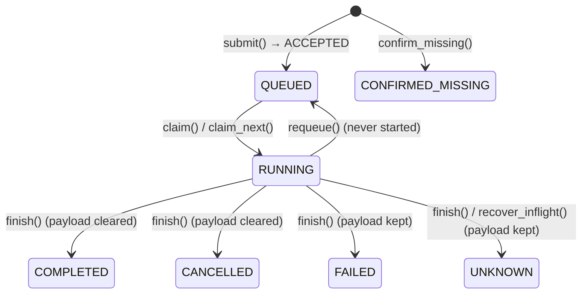

# Durable Chat Queue

**English** | [한국어](README.ko.md) | [日本語](README.ja.md)

A durable, idempotent operation inbox for chat and agent backends, built on one
SQLite file and the Python standard library (no runtime dependencies).

Every chat or agent service eventually has to answer three questions:

- The user sends a second message while the assistant is still working on the
  first. **What happens to the running turn?**
- A phone on a flaky network retries the same request, or two devices post to
  the same conversation at once. **How many turns run?**
- The service restarts in the middle of a turn that may already have called a
  tool, sent a message or spent API credit. **Is the turn run again?**

Durable Chat Queue's answers: the running turn is neither cancelled nor
duplicated, because the new message is durably queued behind it; a retry of the
same operation is recognised and replayed, never executed twice; and work that
was in flight during a crash is marked `UNKNOWN` and never re-executed
automatically.

## Why this matters

Chat and agent turns are not ordinary background jobs:

- **They are ordered within a conversation.** Turn *n + 1* is written against
  the reply to turn *n*. Running them concurrently or out of order answers a
  stale context.
- **They are independent across conversations.** One slow conversation should
  not stall everyone else.
- **Their side effects can have an unknown outcome.** A model call, tool call or
  outgoing message may have taken effect even if the process died before it
  recorded the result. Re-running such a turn "to be safe" can send a message
  twice or repeat a paid call.
- **Clients retry.** Mobile networks drop responses, users tap twice, and several
  devices share one conversation.

An in-memory "busy" flag gets the edges wrong: a second message either cancels
the running turn, is rejected, or starts a second concurrent turn; a restart
either loses queued messages or re-runs everything. This library moves the
decision into a small, transactional state machine.

## What it guarantees

Scope: one service process (any number of threads or asyncio tasks) that owns
one local SQLite file, with callers that follow the protocol described under
[Dispatcher pattern](#dispatcher-pattern).

| Guarantee | Mechanism |
|---|---|
| **Idempotent submission.** A `client_operation_id` is accepted at most once. The same id with the same canonical payload returns `REPLAY` (the existing row, whatever its state); the same id with a different payload returns `CONFLICT`. A `request_id` cannot be rebound to a second operation either. | `UNIQUE` constraints plus a SHA-256 of the canonical JSON payload, checked inside one `BEGIN IMMEDIATE` transaction. |
| **Server acceptance order.** Each accepted operation gets an increasing `sequence`. | `INTEGER PRIMARY KEY AUTOINCREMENT`. |
| **At most one RUNNING operation per conversation, in FIFO order.** | `claim()` and `claim_next()` check running conversations and the oldest queued sequence in the same write transaction as the `QUEUED → RUNNING` update. |
| **Bounded parallelism across conversations.** At most `lanes` conversations run at once. | The same transaction counts distinct RUNNING conversations. |
| **No silent re-execution after a restart.** `recover_inflight()` turns every RUNNING row into `UNKNOWN`; never-started `QUEUED` rows stay and can drain. | `claim*()` only ever selects `QUEUED` rows. |
| **Recovery inbox.** `FAILED` and `UNKNOWN` rows keep the exact submitted payload. `COMPLETED` and `CANCELLED` rows drop it and keep only the receipt (`payload_sha256`, `message_id`, `error_code`, timestamps). | `finish()` clears the payload only for `COMPLETED` and `CANCELLED`. |
| **Negative receipts.** A client that gave up on an operation it believes was never received can seal the id with `confirm_missing()`. A late copy of that request is then recognised but never queued. | A `CONFIRMED_MISSING` tombstone inserted in one transaction. |

What it deliberately does **not** do: cancel a running turn (that is the
executor's job; record the outcome as `CANCELLED`), retry anything
automatically, or decide what should happen to `UNKNOWN` work.

## Design

### States



`COMPLETED`, `CANCELLED`, `FAILED`, `UNKNOWN` and `CONFIRMED_MISSING` are final:
no method moves a row out of them.

### Storage

- One table, `chat_operations`: `sequence`, `client_operation_id` (unique),
  `request_id` (unique), `conversation_id`, `device_id`, `workspace_id`,
  `payload_sha256`, `payload_json`, `state`, `message_id`, `error_code`,
  `created_at`, `updated_at`, `started_at`, `completed_at`, with indexes on
  `(state, sequence)` and `(conversation_id, sequence)`.
- Every public method opens a short-lived connection (`busy_timeout=5000`, WAL
  journal). Methods that check and then write start with `BEGIN IMMEDIATE`, so
  the check and the update are serialised against every other writer on the
  same file.
- Payloads are canonicalised with
  `json.dumps(sort_keys=True, separators=(",", ":"), ensure_ascii=False)` and
  hashed with SHA-256. Key order and whitespace do not matter; any change of
  value does.
- If a payload has a `workspace_id` key, its value is also stored in its own
  column so the scope survives payload compaction. When an older database
  without that column is opened, the column is added and rows that still have a
  payload are backfilled. Rows whose payload was already cleared stay `NULL`
  instead of being guessed.
- The store is an inbox, not a transcript. Messages and replies belong in your
  conversation history; the store only remembers identities, order, transient
  payloads and receipts.

### Dispatcher pattern

In the original service, an asyncio HTTP backend used the store like this:

1. **Startup:** call `recover_inflight()` once, then start up to `lanes` drain
   tasks.
2. **New request:** call `submit()`.
   - `CONFLICT` → reject (HTTP 409).
   - `REPLAY` → return the existing receipt. If the row is still `QUEUED`, make
     sure a drain task is running. If it is `CONFIRMED_MISSING`, reject.
   - `ACCEPTED` → try `claim(op_id, lanes=lanes)` to run the turn inline. If it
     returns `None` (the conversation is busy, all lanes are in use, or an
     older message of the same conversation is waiting), answer "queued"
     immediately and let a drain task pick it up.
3. **Drain loop:** `claim_next(lanes=lanes)` → execute → `finish()`; repeat
   until it returns `None`.
4. **Outcome mapping:** success → `COMPLETED`; user cancel → `CANCELLED`; a
   failure proven to happen before any side effect → `FAILED`; any other
   exception, lost response or task cancellation in the middle of a turn →
   `UNKNOWN`. If the executor refuses to start the turn at all (for example an
   in-memory lane gate disagrees), call `requeue()`.

A minimal asyncio skeleton (your `run_turn` and error type):

```python
import asyncio

async def drain(store, lanes):
    while (row := store.claim_next(lanes=lanes)) is not None:
        await execute(store, row)

async def execute(store, row):
    op = row["client_operation_id"]
    try:
        reply = await run_turn(row["payload"])
    except asyncio.CancelledError:
        store.finish(op, state="UNKNOWN", error_code="cancelled_inflight_unknown")
        raise
    except ProvenPreSideEffectError as exc:
        store.finish(op, state="FAILED", error_code=type(exc).__name__)
    except Exception as exc:
        store.finish(op, state="UNKNOWN", error_code=f"{type(exc).__name__}:outcome_unknown")
    else:
        store.finish(op, state="COMPLETED", message_id=reply.message_id)
```

[`examples/threaded_dispatcher.py`](examples/threaded_dispatcher.py) is a
runnable, thread-based version of the same pattern with synthetic data.

## Quick start

```bash
git clone <this repository> && cd durable-chat-queue
python -m pip install -e .
python examples/threaded_dispatcher.py
```

```python
from pathlib import Path
from durable_chat_queue import ChatOperationStore

store = ChatOperationStore(Path("operations.db"))
store.recover_inflight()  # once, at process start, before any worker runs

disposition, op = store.submit(
    client_operation_id="op-7f3a",  # generated by the client, reused on retry
    request_id="op-7f3a",
    conversation_id="conv-42",
    device_id="laptop",
    payload={"text": "Summarise this thread", "workspace_id": "team-a"},
)
# disposition is "ACCEPTED", "REPLAY" or "CONFLICT"

row = store.claim_next(lanes=2)
if row is not None:
    try:
        message_id = run_turn(row["payload"])  # your model / tool call
    except Exception as exc:
        store.finish(row["client_operation_id"], state="UNKNOWN",
                     error_code=type(exc).__name__)
    else:
        store.finish(row["client_operation_id"], state="COMPLETED",
                     message_id=message_id)
```

Excerpt of the example output (timings vary):

```text
[2] restart: fence uncertain work, keep never-started work
  recover_inflight() fenced 1 operation(s)
  op-0001: UNKNOWN  error_code=service_restart_inflight_unknown
  op-0002: QUEUED   error_code=None
...
  retry  op-0004 with the same bytes:      REPLAY
  reuse  op-0004 with different content:   CONFLICT
...
  checked: per-conversation FIFO, no overlap inside a conversation, peak parallel turns = 2 (lanes = 2)
```

## API overview

All methods are synchronous and safe to call from several threads; each call
uses its own connection.

| Call | Purpose | Returns |
|---|---|---|
| `ChatOperationStore(path)` | Store backed by the SQLite file at `path` (parent directories are created). | — |
| `submit(*, client_operation_id, request_id, conversation_id, device_id, payload)` | Accept a turn once. | `("ACCEPTED" \| "REPLAY" \| "CONFLICT", row)` |
| `claim(client_operation_id, *, lanes=1)` | Start one exact operation if it is the oldest queued one of its conversation, the conversation is idle and a lane is free. | row or `None` |
| `claim_next(*, lanes=1)` | Start the oldest queued operation whose conversation is idle, if a lane is free. | row or `None` |
| `finish(client_operation_id, *, state, message_id=None, error_code=None)` | Record the receipt of a RUNNING operation. `state` ∈ `COMPLETED`, `FAILED`, `CANCELLED`, `UNKNOWN`. | row; `ValueError` for another state, `KeyError` if not RUNNING |
| `requeue(client_operation_id, *, error_code=None)` | Put a RUNNING operation that never started back to `QUEUED` (same sequence). | `None` |
| `recover_inflight()` | Mark every RUNNING operation `UNKNOWN`. Call at startup only. | number of rows fenced |
| `confirm_missing(*, client_operation_id, request_id, conversation_id, device_id, workspace_id, payload_sha256)` | Seal an id the client believes was never received. | `("CONFIRMED_MISSING" \| "EXISTING", row)` |
| `get(client_operation_id)` | Read one operation. | row or `None` |
| `list(*, conversation_id, after_sequence=0, limit=50)` | Page through a conversation (1–100 rows). | list of rows |
| `counts()` | Number of operations per state. | `dict[str, int]` |
| `canonical_payload(payload)` | Canonical JSON and its SHA-256 (use it on the client for `confirm_missing`). | `(json_text, sha256_hex)` |

A row is a `dict` with the table columns, except that `payload_json` is
replaced by `payload` (the decoded dict, or `None` once cleared).

## Running tests

```bash
python -m venv .venv
. .venv/bin/activate          # Windows: .venv\Scripts\activate
python -m pip install -e ".[test]"
pytest -q
```

CI runs the tests and the example on Ubuntu and Windows with Python 3.10 and
3.13.

## Limitations and non-goals

- **Single host, single owning process.** `BEGIN IMMEDIATE` makes claims atomic
  across threads, and across processes on the same machine, but there are no
  leases or heartbeats. `recover_inflight()` fences *every* RUNNING row, so call
  it only at startup before any worker runs, and do not let several service
  processes that each call it share one file. This is not a distributed queue,
  and the file should not live on a network filesystem (SQLite WAL needs
  shared memory on one host).
- **A stuck worker blocks its conversation.** If a worker stops without calling
  `finish()` while the process keeps running, its conversation stays RUNNING
  (and blocked) until the next `recover_inflight()`. Always record a receipt on
  every exit path.
- **`lanes` is a per-call argument**, not stored configuration. All callers
  should pass the same value.
- **No retry policy.** There is no automatic retry, backoff, priority, delayed
  delivery, TTL or dead-letter handling. `FAILED` and `UNKNOWN` rows wait for
  your application or a person to act; there is no API that re-queues them.
  Resubmitting means a new `client_operation_id`.
- **No retention.** Rows, including receipts, are never deleted. Archive or prune
  them yourself.
- **Built for human-paced traffic.** Each call opens a fresh connection and
  re-runs the idempotent schema check. That keeps the code simple and robust,
  but it has not been benchmarked for high-throughput job processing.
- Payloads must be JSON-serialisable dicts; the store does not limit their size.
  During legacy backfill, `workspace_id` values longer than 80 characters are
  ignored.
- `confirm_missing()` trusts the caller to compute `payload_sha256` with the same
  canonicalisation as `canonical_payload()`.
- Timestamps are UTC ISO-8601 strings from the local clock; ordering always uses
  `sequence`, never time.

## Origin

This code was extracted from willind, a discontinued personal AI-assistant
project, where it served as the command inbox between desktop/mobile chat
clients and a local assistant service. The store logic is unchanged. For this
release, comments were translated to English, docstrings were added to public
methods, connections are now closed explicitly, and the surrounding HTTP
service was replaced by a synthetic example.

## License

Apache License 2.0. See [LICENSE](LICENSE) and [NOTICE](NOTICE).
